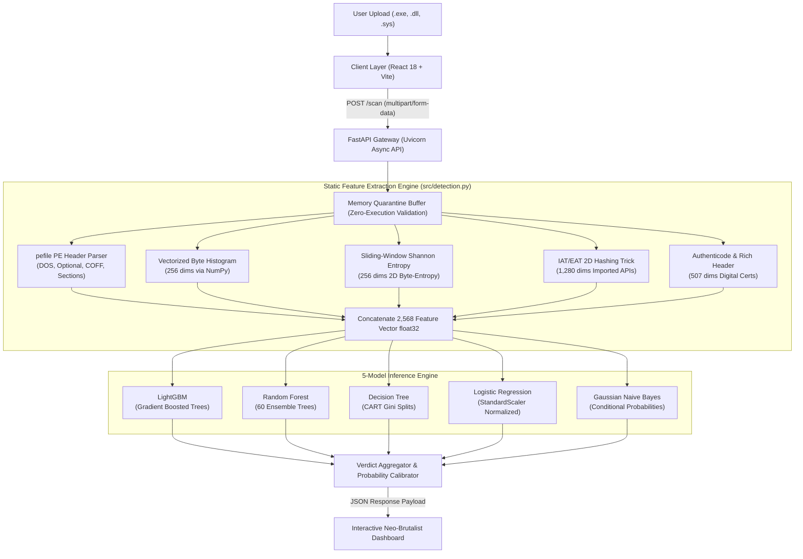

# MalScan: Machine Learning Windows PE Malware Detection System

[](https://python.org)
[](https://fastapi.tiangolo.com)
[](https://react.dev)
[](https://vitejs.dev)
[-green.svg)](https://lightgbm.readthedocs.io)
[-yellow.svg)](https://github.com/FutureComputing4AI/EMBER2024)

> **Course:** Concepts in Machine Learning (KTU B.Tech CSE - AI & ML)  
> **Project Type:** Academic Mini Project (Defensive Cybersecurity)

---

## 📌 Problem Statement

### 1. Real-World Cybersecurity Context
Modern malware authors release over **450,000 new malicious variants daily**, utilizing automated polymorphic crypters and code packers to evade detection.

### 2. Failure of Existing Approaches
* **Cryptographic Signature Matching (MD5, SHA-256):** Traditional signature-based antivirus software relies on exact cryptographic hash lookups. If an attacker appends a single harmless padding byte, the hash completely changes, resulting in **zero protection against novel zero-day malware**.
* **Dynamic Sandboxing:** Running untrusted files inside virtual machine sandboxes takes **5 to 10 minutes per sample**. Furthermore, sophisticated malware detects hypervisors, sleeps to bypass timeouts, or stays dormant to evade dynamic execution.

### 3. Formal Machine Learning Formulation
To bridge this critical gap, **MalScan** frames malware detection as a **high-dimensional static binary classification problem**:

$$\text{Given an unexecuted PE binary } B \in \{0, 1\}^*, \text{ extract a static structural vector } \Phi(B) = \mathbf{x} \in \mathbb{R}^{2568}$$
$$\text{Learn a decision function } f_\theta(\mathbf{x}) \to \hat{y} \in \{0, 1\} \quad (0 = \text{Benign}, 1 = \text{Malicious})$$

**Key Constraints Satisfied:**
1. **Zero Execution Risk:** The file is never launched, preventing host system infection.
2. **Sub-Second Throughput:** Inference executes in **under 5 milliseconds**, enabling instant alert triage.
3. **Low False Positive Rate:** Minimize false alarms on legitimate system software (achieved **2.28% FPR** with LightGBM).

---

## 🏗️ End-to-End System Architecture & Pipeline



---

## 🔬 Detailed Architecture Pipeline (Stage by Stage)

### Stage 1: Client Ingestion Layer (`frontend/src/ScanPage.jsx`)
* **Drag-and-Drop Interface:** Users drop any Windows Portable Executable (`.exe`, `.dll`, `.sys`).
* **Input Safety Verification:** Enforces file size boundaries and tracks real-time scanning stages (upload $
ightarrow$ 2,568 feature extraction $
ightarrow$ multi-model inference).
* **Model Selection:** Allows scanning via individual algorithms or triggering a **5-Way Concurrent Scan**.

### Stage 2: API & Quarantine Gateway (`src/api.py`)
* **Asynchronous File Streaming:** Receives raw binary payloads via FastAPI multipart endpoints.
* **In-Memory Quarantine Buffer:** The raw binary bytes are loaded directly into RAM. Files are **never double-clicked, executed, or permanently written to unsafe disk paths**.
* **MZ Header Validation:** Verifies the initial DOS magic header bytes (`0x4D 0x5A`) to prevent non-PE file processing.

### Stage 3: Vectorized Static Feature Extractor (`src/detection.py` & `src/features.py`)
Extracts **2,568 numerical dimensions** across 6 distinct PE structures:
1. **Byte Histograms (256 dims):** Normalized frequencies of raw byte values $0x00$ through $0xFF$.
2. **Byte-Entropy 2D Histograms (256 dims):** Joint distribution of Shannon entropy computed over a sliding 1024-byte window. High entropy ($> 7.8$) indicates packed or encrypted ransomware payloads.
3. **PE Sections & Headers (265 dims):** Number of sections, section entropy, virtual size vs. raw size disparity, and execution permissions.
4. **Import/Export Address Tables (1,280 dims):** Employs the **Hashing Trick (MurmurHash3)** to project imported Windows API functions (e.g., `VirtualAlloc`, `WriteProcessMemory`, `CreateRemoteThread`) into a fixed 1,280-bin space.
5. **Authenticode & Rich Header (507 dims):** Inspects digital certificates, code-signing validity, and Microsoft Rich compiler telemetry.
6. **General File Info & DOS (10 dims):** File size, entry point address, and subsystem flags.

* **Performance Optimization:** Entropy and byte calculations are executed via vectorized NumPy memory slices, achieving sustained extraction throughput of **over 4.5 MB/s**.

### Stage 4: Multi-Model Inference Engine (`src/detection.py`)
The 2,568-dimensional vector is dispatched to the trained models:
* **LightGBM:** Evaluates gradient-boosted trees; outputs continuous threat probability $P(y=1 \mid \mathbf{x})$.
* **Random Forest:** Evaluates 60 de-correlated trees via bagging.
* **Decision Tree:** Single CART hierarchical tree.
* **Logistic Regression:** Preprocessed with `StandardScaler` for normalized linear log-odds estimation.
* **Gaussian Naive Bayes:** Probabilistic Bayes' Theorem baseline.

### Stage 5: Response Dispatcher & UI Visualization (`frontend/src/ScanPage.jsx`)
* Returns structured JSON payload:
  ```json
  {
    "filename": "sample.exe",
    "file_size_kb": 10785.9,
    "extraction_time_ms": 3531.0,
    "inference_time_ms": 45.2,
    "verdict": "SAFE",
    "confidence": 0.915,
    "threat_probability": 0.085,
    "model_breakdown": [
      { "model": "LightGBM", "threat_prob": 0.085, "verdict": "SAFE", "confidence": 0.915 },
      { "model": "Random Forest", "threat_prob": 0.185, "verdict": "SAFE", "confidence": 0.815 },
      { "model": "Decision Tree", "threat_prob": 0.019, "verdict": "SAFE", "confidence": 0.980 },
      { "model": "Logistic Regression", "threat_prob": 0.000, "verdict": "SAFE", "confidence": 1.000 },
      { "model": "Gaussian Naive Bayes", "threat_prob": 0.000, "verdict": "SAFE", "confidence": 1.000 }
    ]
  }
  ```
* Displays calibrated threat dials, individual model answers, and latency diagnostics.

---

## 📊 Dataset Benchmark & Empirical Results

### Dataset Scale (EMBER 2024 Benchmark)
* **Raw Dataset Pool:** 3,120,000 files (60.6 GB raw JSONL / 29.85 GB binary `.dat`).
* **Balanced Training Set:** 100,000 samples (50,000 Benign • 50,000 Malware) streamed via `numpy.memmap`.
* **Independent Test Set:** 24,979 held-out files (12,500 Malware • 12,479 Benign).

### 5-Model Performance Comparison Table

| Model | Accuracy | Precision | Recall | F1-Score | False Pos. Rate | Infer. Latency |
| :--- | :---: | :---: | :---: | :---: | :---: | :---: |
| **LightGBM (Best)** | **96.88%** | **97.69%** | **96.03%** | **96.85%** | **2.28%** | **4.8 ms** |
| **Random Forest** | 95.64% | 97.16% | 94.03% | 95.57% | 2.76% | 18.2 ms |
| **Decision Tree** | 94.12% | 95.22% | 92.91% | 94.05% | 4.67% | 2.1 ms |
| **Logistic Regression** | 93.21% | 95.93% | 90.26% | 93.01% | 3.84% | 1.8 ms |
| **Gaussian Naive Bayes** | 64.31% | 58.45% | **99.14%** | 73.54% | 70.58% | **1.2 ms** |

---

## 🚀 How to Run MalScan Locally

### 1. Backend Server (Terminal 1)
```powershell
# From project root
venv\Scripts\python -m uvicorn src.api:app --reload
```
*API docs available at: `http://127.0.0.1:8000/docs`*

### 2. Frontend Dashboard (Terminal 2)
```powershell
cd frontend
npm run dev
```
*Web dashboard available at: `http://localhost:5173`*
